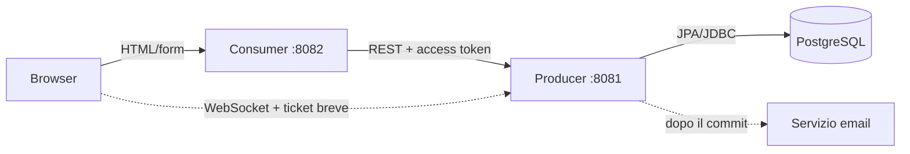
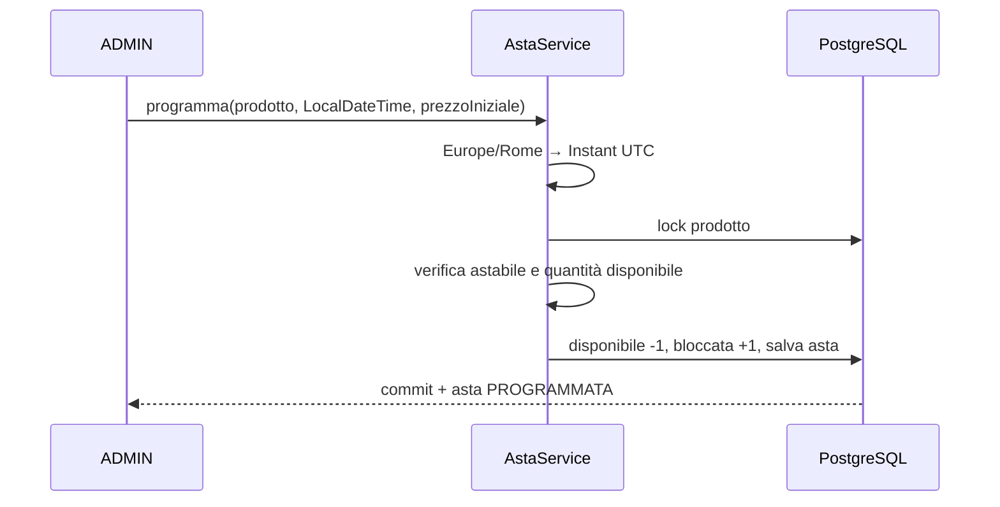
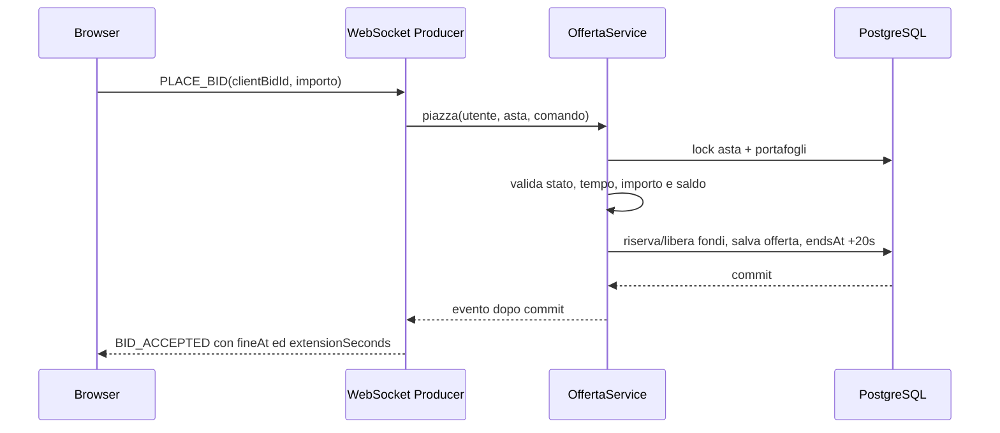

# Architettura e comunicazione

## Vista generale



Il flusso Consumer descritto qui è previsto, ma non ancora implementato in
`main`: sono presenti l'applicazione e la configurazione di base, senza client
REST, controller delle pagine o template applicativi.

La Consumer dovrà rendere Thymeleaf e mantenere access token e refresh token nella
sessione server-side. Il browser invia le credenziali alla Consumer, che chiama
`POST /auth/login` sul Producer. Per ogni chiamata protetta la Consumer invia
`Authorization: Bearer <accessToken>`; alla scadenza usa `POST /auth/refresh` e
sostituisce entrambi i token nella sessione. Al logout chiama
`POST /auth/logout` e svuota la sessione. La Consumer può adattare la UI al
ruolo, ma l'autorizzazione resta al Producer. La sicurezza web della Consumer
è ancora da implementare: attualmente consente tutte le richieste.
Per entrare in una stanza richiede al Producer un ticket WebSocket monouso,
valido 30 secondi. Il token principale non viene esposto al JavaScript.

## Producer

```text
it.esercitazione.liveauction.producer/
├── auth/          utenti, login e ticket WebSocket
├── prodotto/      catalogo, stock e flag astabile
├── inventario/    prodotti assegnati agli utenti
├── portafoglio/   saldo, riserve e ledger
├── asta/          programmazione, offerte e settlement
├── notifica/      email post-vittoria
├── websocket/     endpoint STOMP ed eventi stanza
└── common/        errori, auditing e configurazione
```

Il Producer richiede gli starter Security, WebSocket e Mail oltre a JPA,
Validation, PostgreSQL e Flyway.

## Consumer

```text
it.esercitazione.liveauction.consumer/
├── auth/          login web e sessione
├── client/        client REST verso il Producer
├── web/           controller MVC utente e ADMIN
├── dto/           modelli del contratto
└── config/        sicurezza web e client HTTP
```

Il JavaScript della stanza gestisce presentazione, countdown, riconnessione e
comandi STOMP. Non decide mai apertura, validità, vincitore o saldo.

## Programmazione e stock



## Attivazione temporale

`AstaScheduler` implementa tutti e tre i passaggi, usando gli istanti UTC e
delegando la chiusura a `ChiusuraAstaService`:

1. a `startsAt - 3 minuti` porta l'asta in `STANZA_APERTA`;
2. a `startsAt` la porta in `APERTA` e fissa `endsAt = startsAt + 7 minuti`;
3. a `endsAt` la chiude, salvo estensioni di venti secondi già registrate.

Lo scheduler controlla le aste ogni secondo e recupera le transizioni
arretrate all'avvio, sotto lock e nella transazione dell'asta. Gli snapshot
REST sono letture: non modificano stato o stock. `offerteConsentite` verifica
anche la finestra temporale, quindi è falso per un'asta scaduta ancora
`APERTA`. I servizi di offerta e chiusura ricontrollano stato e scadenza sotto
lock, senza affidarsi ai soli aggiornamenti periodici. La chiusura avviene in
una fase separata dopo le aperture; gli errori sono isolati per asta e
ritentati al ciclo successivo, anche durante il recupero all'avvio.

Nelle API e negli eventi implementati i campi temporali si chiamano `inizioAt`
e `fineAt`; `startsAt` ed `endsAt` nei diagrammi indicano gli stessi concetti.

## Flusso offerta



## Chiusura

La chiusura usa lock su asta, prodotto, inventario e portafogli e verifica di
nuovo stato e `endsAt`. Il trasferimento è idempotente. Dopo il commit vengono
pubblicati `AUCTION_CLOSED` e la richiesta di email; un problema email non
esegue rollback della vittoria.

L'ordine effettivo dei lock del settlement è asta, portafogli ordinati per ID,
prodotto e inventario. Per le operazioni economiche condivise vedere
[Offerte e chiusura](08-offerte-chiusura.md#persistenza-e-concorrenza).

## WebSocket e resilienza

- Protocollo STOMP su endpoint `/ws`.
- Join rifiutato prima dell'apertura della stanza.
- Nel pre-live sono permessi join e presenza, non le offerte.
- Topic pubblico per asta e coda privata per rifiuti e conferme sensibili.
- Heartbeat client/server ogni 10 secondi.
- Origine browser attualmente ammessa: `http://localhost:8082`, configurata in
  `WebSocketConfig`; un ambiente con URL diverso richiede di adeguare questa regola.
- Nessun tick al secondo dal server: il browser interpola il timer.
- Snapshot REST al primo ingresso, alla riconnessione e in caso di gap di
  `sequence`.

## Docker

Il profilo Compose `prod` mantiene l'ordine:

```text
PostgreSQL healthy → Producer healthy → Consumer healthy
```

Nel network Docker gli URL sono `postgres:5432` e `producer:8081`; dall'host le
porte rimangono 5432, 8081 e 8082, configurabili da `.env`.
